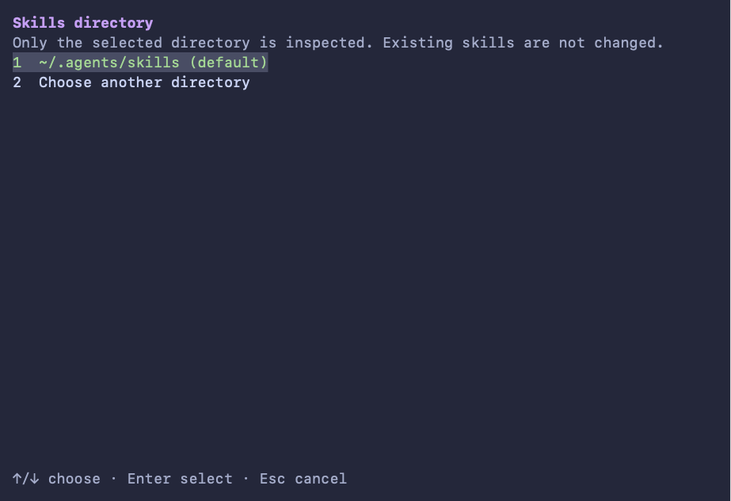
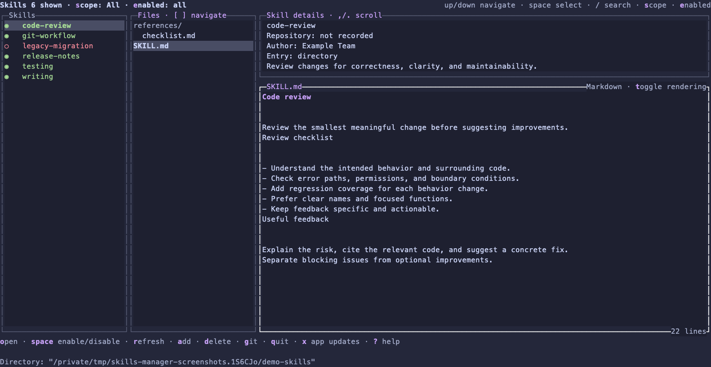
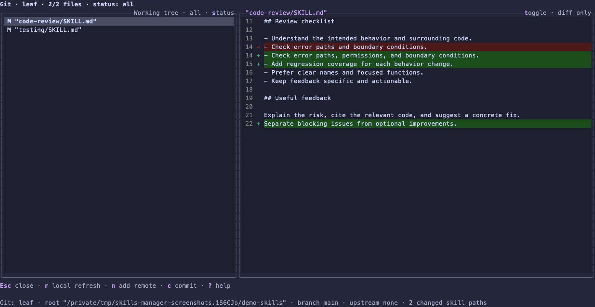

# skills-manager

## Paste this into your coding agent

```text
Make sure Node.js/npm and Git are available, installing missing requirements if needed.
Open an interactive terminal and run:

npx --yes github:ederheisler/skills-manager

This launcher installs the Vercel skills dependency automatically.
Do not install a separate global skills CLI or the unrelated npm skills-manager package.
Do not substitute a clone or manual build.
Let me complete setup inside the app.
```

Browse and manage agent skills in a terminal on macOS and Linux. The app uses `~/.agents/skills` by default and can open another skills directory. Local browsing needs neither Git nor a global `skills` CLI.

AI coding agents wrote most of the code under the maintainer's guidance.

## Quick start

Run this command in an interactive terminal:

```sh
npx --yes github:ederheisler/skills-manager
```

Complete setup inside the app. Choose the default `~/.agents/skills` directory or select another directory. There are no separate command-line setup prompts.

Press `g` to open Git view. If the selected directory has no repository, the app offers initialization with explicit confirmation. Browsing does not require Git.

You can use the same `npx` command for later launches. For a persistent installation, press `x` in browse mode to open Application updates. Press `r` and approve the persistent installation. The app uses the configured npm global prefix and restarts after installation.

After that installation, run:

```sh
skills-manager
```

The launcher downloads the project and builds it locally. To select a directory directly, run `npx --yes github:ederheisler/skills-manager --skills-dir /absolute/path/to/skills`. The path is the skills directory itself, not its parent.

## Screenshots

### Onboarding



### Browse



### Git



## Requirements

- Node.js 26.13.0 or later in the 26.x release line, with native FFI support.
- npm and Git to download dependencies. No C compiler is required; OpenTUI supplies its published prebuilt runtime binaries.
- A terminal. A Nerd Font is not required.
- macOS or Linux with glibc, on arm64 or x86_64. Windows and Linux with musl are not supported.

Once built, local browsing needs Node, a terminal, and a supported operating system. It does not need Git or a global `skills` CLI. Remote preparation on Linux needs Bubblewrap and the required kernel permissions. Optional in-app Git actions need Git 2.48 or later. See the [security policy](https://github.com/ederheisler/skills-manager/blob/main/SECURITY.md) for details.

## Application and CLI updates

In browse mode, press `x` to open Application updates. Each opening requests an immediate check of both components, even when automatic checks are off. Press `c` to check the selected component again. These actions do not enable automatic checks. Background checks default to off and require separate persistent opt-ins for their disclosed hosts. Enter opens the opt-in prompt, and `y` approves it. You can disable either check.

The app check contacts `api.github.com`. The CLI check contacts the configured npm registry, `registry.npmjs.org` by default. Each host sees your connection's IP address. An opt-in starts a check, then permits daily checks for that component and host while the app runs. Completed results are saved and the menu shows when a check is in progress.

The app check compares the running build's full commit SHA with GitHub `main`. The CLI check compares its resolved version with the registry's `latest` tag. A different commit is not necessarily newer, and `latest` does not guarantee compatibility. An unknown identity or unavailable check is not a match.

Update and restart installs the app from `main` and refreshes the CLI. A CLI-only refresh keeps a verified, clean app commit and selects the latest CLI. Both actions update the persistent npm-global installation and restart the app. An update from a checkout or temporary installation requires explicit approval before global installation. The app does not overwrite the checkout.

After approval, the terminal shows download, build, installation, and restart progress. If a step fails, it shows the reason and a recovery command.

npm runs repository and dependency scripts with your normal permissions. Approve only trusted code. The update does not use `sudo`. After a failed update of an existing persistent installation, start the app again with `skills-manager --skills-dir /absolute/path/to/skills`. See the [security policy](SECURITY.md#application-and-cli-updates) for details.

## Development

Clone the repository only to work on the code. A clone is not required to run the app.

```sh
git clone https://github.com/ederheisler/skills-manager.git
cd skills-manager
npm ci
node dist/cli.js
```

For development, use `npm run dev`. Rebuild with `npm run build` after changing the source.

Run `npm test` before opening a pull request. The Release workflow runs on pushes to `main` and publishes new manifest versions. No hosted build or test checks run.

## Using the app safely

In-app onboarding offers `~/.agents/skills` as the default or lets you choose another directory. Press Enter to select the default. If the directory is missing, onboarding offers read-only mode and does not create it. A linked directory requires approval of its resolved target. Completed setup is saved in `$XDG_CONFIG_HOME/skills-manager/config.json` when `XDG_CONFIG_HOME` is absolute. Otherwise, the path is `~/.config/skills-manager/config.json`. Later launches reuse setup for an unchanged root. A new or changed root requires setup again.

Onboarding does not merge or move skills, create Git state, rewrite installer locks, or ask about Git. Press `g` to open Git view. If no repository exists, the app offers explicit initialization. You can also press `i` in Git view to open its confirmation. File changes and local commits remain scoped to the selected skills directory. The app never initializes Git, commits, changes a remote, or pushes automatically. Review dialogs default to cancellation.

Push is an explicit action in Git view. It sends branch history for the whole repository, including commits outside the selected skills directory. Review the repository, destination, and history before approving a push. Push does not include uncommitted changes.

The underlying `skills` CLI is the backend for discovery, installation, update checks, and updates. The app uses its `find`, `add`, `check`, and `update` commands; it does not independently decide which versions need updating. Known sources are checked in the background on startup and refresh. Checks do not install updates.

The middle footer row right-aligns action messages, update checks, and background notices; shortcuts appear above it and the selected directory below. It shows available updates and source-associated skills that could not be checked. Local skills without a recorded source are excluded. While checks run, it shows `Checking skill updates…`. Available skills have a list marker; unavailable checks retain the affected skill and reason.

Press `u` to update the selected skill or `p` to update all available skills immediately. Neither shortcut asks for confirmation or displays the full skill. The CLI performs the update and generates its tracking; the app confines the operation and safely publishes those results, preserving unrelated entries. Installation and replacement confirmations are unchanged.

Press `?` for help in the current view. In browse mode, `x` opens Application updates and appears immediately before `?`. Git controls and repository status appear in Git view, not the browse footer. Shortcuts use Option on macOS and Alt on Linux.

The browse filter offers All, From a repo, and Local. Local includes skills without a recorded remote association. It does not mean that you authored them.

In the skill list, ◉ means enabled, ○ means disabled, and ! means missing. ⎇ marks a repository source. No source marker means local. No special font is required. Up and Down keep the selected skill visible and stop at the ends of the list.

Local browsing works without network access, though background skill update checks can be unavailable. Automatic app and CLI update checks require the separate opt-ins described above. Search, remote installation, fetch, pull, and push require explicit actions. Remote preparation runs behind an operating-system boundary, not a general-purpose hostile-code sandbox. Do not edit or move files, or run Git commands, concurrently with an app action.

Local file and Git safeguards run inside the TypeScript app, not an operating-system confinement boundary. They check approved roots, normalized paths, links, stale previews, and recovery state. They do not protect against hostile concurrent filesystem or Git changes.

See the [security policy](https://github.com/ederheisler/skills-manager/blob/main/SECURITY.md) for file operations, remote actions, privacy, recovery, and vulnerability reporting.

## More information

- [Release plan and test evidence](https://github.com/ederheisler/skills-manager/blob/main/docs/superpowers/plans/2026-11-03-portable-open-source-release.md#release-completion)
- [Product decisions](https://github.com/ederheisler/skills-manager/blob/main/docs/decisions/README.md) and the [historical design](https://github.com/ederheisler/skills-manager/blob/main/docs/superpowers/specs/2026-09-16-skills-manager-design.md)
- [MIT license](LICENSE) and [third-party notices](THIRD_PARTY_NOTICES)
